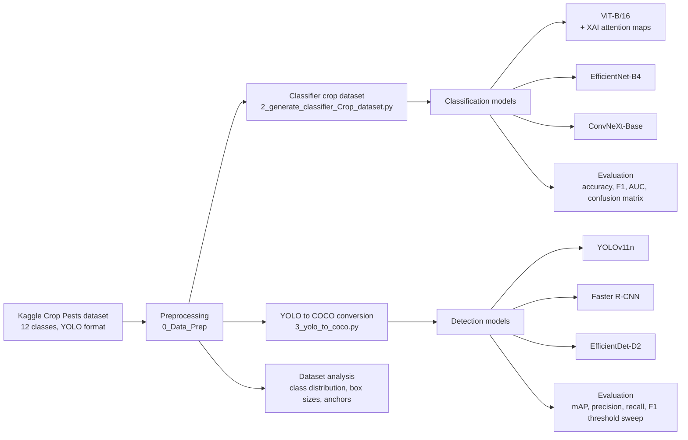

# Crop Pest Detection & Classification — Architecture Benchmarking

A benchmark of six deep learning models for crop pest identification, run as three detector/classifier pairs on the same 12-class pest dataset.

This project trains and evaluates three object detectors (YOLOv11n, Faster R-CNN, EfficientDet-D2) and three image classifiers (ViT-B/16, EfficientNet-B4, ConvNeXt-Base) on the [Crop Pests dataset](https://www.kaggle.com/datasets/rupankarmajumdar/crop-pests-dataset) (11,502 train / 1,095 validation images, 12 pest classes). The goal is to compare how modern detection and classification architectures handle small, visually similar pest categories — including an explainability (XAI) analysis of the ViT classifier. All reported metrics are reproducible from the evaluation logs committed in this repo.

## Results

Classifiers (evaluated on 1,341 validation crops):

| Model | Architecture | Accuracy | Macro F1 | AUC (OvR) |
|---|---|---|---|---|
| ViT | vit_base_patch16_224 | **0.934** | 0.930 | 0.995 |
| EfficientNet | EfficientNet-B4 | 0.914 | 0.912 | 0.991 |
| ConvNeXt | ConvNeXt-Base | 0.888 | 0.885 | 0.991 |

Detectors (evaluated on 1,095 validation images / 1,341 instances):

| Model | Architecture | mAP@0.5 | mAP@0.5:0.95 | Precision | Recall |
|---|---|---|---|---|---|
| YOLO | yolo11n | **0.825** | 0.536 | 0.852 | 0.746 |
| Faster R-CNN | fasterrcnn_resnet50_fpn | 0.734 | 0.394 | 0.847 | 0.673 |
| EfficientDet | tf_efficientdet_d2 | 0.336 | 0.124 | 0.618 | 0.346 |

Full per-class metrics are in the committed evaluation logs (`*_eval.txt`, `*_map50.txt`) next to each model's scripts.

## Pipeline



## Repository Layout

```
├── 0_Data_Prep/                    # Dataset download, format conversion, and analysis
│   ├── 0_install_libraries.sh      #   venv + dependency install (Ubuntu/apt based)
│   ├── 1_download_data.py          #   downloads the Kaggle crop pests dataset
│   ├── 2_generate_classifier_Crop_dataset.py  # crops detections into a classification dataset
│   ├── 3_yolo_to_coco.py           #   converts YOLO labels to COCO JSON for non-YOLO detectors
│   ├── 4–8_*.py / *.txt            #   class distribution, box-size, anchor-match, imbalance analysis
├── 1_Yolo_ViT/
│   ├── Yolo/                       # YOLOv11n train/eval scripts + mAP log
│   └── ViT/                        # ViT train/eval/XAI scripts, confusion matrix, attention maps
├── 2_FRCNN_EfficientNet/
│   ├── Faster_RCNN/                # Faster R-CNN train/eval + F1 threshold sweep + mAP log
│   └── EfficientNet/               # EfficientNet-B4 train/eval + confusion matrix
├── 3_EfficientDet_ConvNext/
│   ├── EfficientDet/               # EfficientDet-D2 train/eval, with/without augmentation logs
│   └── ConvNext/                   # ConvNeXt-Base train/eval + confusion matrix
├── Jupyter_version/                # Notebook versions of all four stages (data prep + 3 model pairs)
└── readme_to_run.txt               # Original run order (uses hardcoded paths — see How to Run)
```

## How to Run

The scripts contain hardcoded absolute paths (`/home/thomas/...`); replace these with your own project path before running, as noted in `readme_to_run.txt`.

```bash
# 1. Environment (creates env/ venv and installs PyTorch 2.2.2+cu118,
#    ultralytics, timm, effdet, pycocotools, kagglehub, etc.)
#    Note: targets Ubuntu/apt and contains two typos to fix first
#    ("pip isntall pandas", "albumentations == 1.4.16").
bash 0_Data_Prep/0_install_libraries.sh
source env/bin/activate

# 2. Data prep — download from Kaggle, build classifier crops,
#    convert YOLO labels to COCO, analyze the dataset
python3 0_Data_Prep/1_download_data.py
python3 0_Data_Prep/2_generate_classifier_Crop_dataset.py
python3 0_Data_Prep/3_yolo_to_coco.py
python3 0_Data_Prep/4_analyze_class_distribution.py

# 3. Train and evaluate the classifiers
python3 1_Yolo_ViT/ViT/1_train_ViT.py            && python3 1_Yolo_ViT/ViT/2_evaluate_ViT.py
python3 2_FRCNN_EfficientNet/EfficientNet/1_train_efficient_net.py \
    && python3 2_FRCNN_EfficientNet/EfficientNet/2_evaluate_efficient_net.py
python3 3_EfficientDet_ConvNext/ConvNext/1_train_convNeXt.py \
    && python3 3_EfficientDet_ConvNext/ConvNext/2_evaluate_convNeXt.py

# 4. Train and evaluate the detectors
python3 1_Yolo_ViT/Yolo/1_train_Yolo.py          && python3 1_Yolo_ViT/Yolo/2_evaluate_Yolo.py
python3 2_FRCNN_EfficientNet/Faster_RCNN/1_train_faster_RCNN.py \
    && python3 2_FRCNN_EfficientNet/Faster_RCNN/3_evaluate_FRCNN.py
python3 3_EfficientDet_ConvNext/EfficientDet/1_train_efficient_det.py \
    && python3 3_EfficientDet_ConvNext/EfficientDet/2_evaluate_efficient_det.py
```

Alternatively, run the notebooks in `Jupyter_version/` for an end-to-end walkthrough of each stage. A Kaggle account (for `kagglehub`) is required to download the dataset.

## Key Findings & Limitations

- ViT was the strongest classifier (0.934 accuracy, 0.930 macro F1); all three classifiers exceeded 0.88 accuracy, with Earthworms, Beetles, and Caterpillars the most confused classes.
- YOLOv11n was the strongest detector (mAP@0.5 0.825 vs. 0.734 for Faster R-CNN and 0.336 for EfficientDet-D2), and also the fastest to evaluate (~35.6 ms inference per image in the eval log).
- Small pests are a weak spot: Faster R-CNN scores 0.000 AP on COCO-small boxes and 0.028 on medium (see `FRCNN_map50.txt`). This matters less here than in typical benchmarks, since ~89% of boxes in this dataset are COCO-large (see `0_Data_Prep/5_analyze_small_ratio.txt`).
- EfficientDet-D2 underperformed substantially (mAP@0.5 0.336, with zero AP on several classes including Ants); training logs with and without augmentation are included for comparison.
- Explainability: attention maps for the ViT classifier (in `1_Yolo_ViT/ViT/xai_vit_multi/`) visualize which image regions drive its predictions, as a sanity check that the model attends to pest features.
- Limitations: all metrics are reported on the validation split (no held-out test evaluation is committed); scripts use hardcoded absolute paths; evaluation ran on consumer hardware (single GPU / CPU), so no training-time or throughput benchmark is included.

## Credits

This was a team project for the UNSW course COMP9517 (Computer Vision), built collaboratively; this repository mirrors the team's shared codebase. Dataset: [Crop Pests Dataset](https://www.kaggle.com/datasets/rupankarmajumdar/crop-pests-dataset) by rupankarmajumdar on Kaggle. Models are from Ultralytics, torchvision, and timm.
